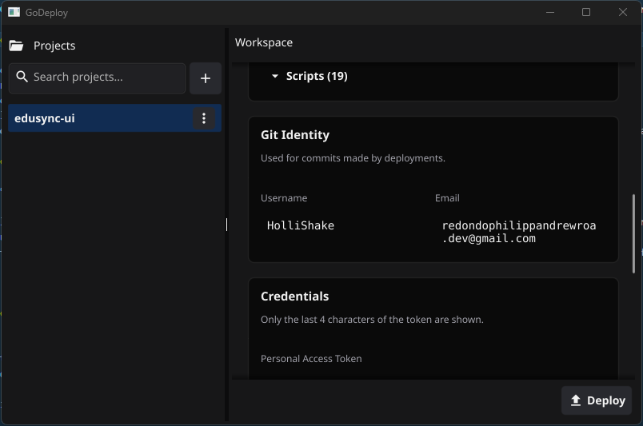

# GoDeploy

GoDeploy is a desktop app for managing Git-backed Node.js projects and running a local npm deployment pipeline.

> **Current scope:** The Deploy workflow clones a repository and installs/builds it locally. It does not currently start or manage applications with PM2, and it does not run Bun commands.

## Screenshot



## Features

- Create, edit, search, and delete projects.
- Configure a repository URL, branch, optional personal access token, and Git identity.
- View detected `package.json` metadata and sorted script names/commands.
- Follow deployment output and status in the app.
- Clone private HTTPS repositories with a personal access token. The token is masked in project details, redacted from Git output, and removed from the checkout's `origin` URL after cloning.

## Deploy workflow

The **Deploy** button runs these steps in order and stops if a step fails:

1. Clone the selected branch into GoDeploy's data directory. If the project directory already exists, it is reused; GoDeploy does not pull updates.
2. Run `npm install`. If it fails, retry once with `--legacy-peer-deps`.
3. If `package.json` defines a `build` script, run `npm run build` and require a `dist/` output directory. If there is no build script, skip this step.

Git, npm, and build output is shown in the deployment terminal.

## Requirements

- Go 1.25.5 or later to run from source.
- Git available on `PATH`.
- Node.js with npm available on `PATH`.

PM2 is not required by the current workflow because PM2 process start/restart is not implemented.

## Run from source

The UI and shared function code are separate Go modules. From the repository root:

```sh
cd ui
go run .
```

## Tests

Run tests from each module directory:

```sh
cd function
go test ./...
```

```sh
cd ui
go test ./...
```

## Project data

GoDeploy creates its configuration file on first launch:

- Windows: `%APPDATA%\GoDeploy\config.json` (or `%LOCALAPPDATA%` if `%APPDATA%` is unavailable)
- macOS: `~/Library/Application Support/GoDeploy/config.json`
- Linux and other Unix-like systems: `$XDG_CONFIG_HOME/GoDeploy/config.json`, or `~/.config/GoDeploy/config.json` when `XDG_CONFIG_HOME` is unset

Project checkouts are stored alongside this configuration file. Personal access tokens are stored in the configuration file, so protect it like a secret.
